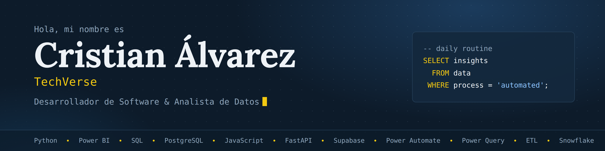

<div align="center">



<br>


<br>

[](https://cristianda.vercel.app)
[](https://www.linkedin.com/in/cristian-alvarez-562811223/)
[](mailto:cristian.techverse@gmail.com)

</div>

<br>

## Sobre mí

<table>
<tr>
<td width="50%" valign="top">

### Desarrollador de Software

Construyo APIs y sistemas completos con Python, FastAPI, Supabase y JavaScript, desde el modelo de datos hasta la interfaz que usa el cliente cada día.

Diseño soluciones a la medida: trabajé en sistemas web que operan 100% en local, con impresión de comprobantes e inventario en tiempo real.

</td>
<td width="50%" valign="top">

### Analista de Datos

Transformo bases de datos en conocimiento visual: dashboards en Power BI y procesos ETL automatizados con Power Query, Power Automate, SQL y PostgreSQL, conectando fuentes como Snowflake y SharePoint.

Automaticé informes que tomaban horas de trabajo manual a diario y los convertí en procesos que se ejecutan solos.

</td>
</tr>
</table>

```sql
-- daily routine
SELECT insights
  FROM data
 WHERE process = 'automated';
```

**Cómo trabajo:** uso herramientas de IA dentro de mi flujo de desarrollo (prototipos, depuración, pruebas y documentación) para entregar más rápido. Yo diseño la solución, reviso el código y respondo por lo que llega a producción.

**Hacia dónde voy:** quiero especializarme en Inteligencia Artificial aplicada a robótica y automatización, siempre optimizando procesos y resolviendo problemas complejos.

<br>

## Habilidades

**Desarrollo de software**


**Análisis de datos y BI**


<br>

## Proyectos destacados

Soluciones reales que resolvieron problemas reales en producción.

<table>
<tr>
<td width="33%" valign="top">

<a href="https://cristianda.vercel.app/#proyectos"></a>

**Districampo** · POS e inventario en producción

Sistema de punto de venta para una empresa de concentrados que registraba todo en cuadernos. Hoy opera en 2 locales con ventas, inventario, clientes, roles de usuario, comprobantes impresos y exportación a Excel.

<sub>JavaScript · FastAPI · PostgreSQL · HTML/CSS</sub>

</td>
<td width="33%" valign="top">

<a href="https://cristianda.vercel.app/#proyectos"></a>

**Tableros BI automatizados** · Power BI

Dashboards que automatizan procesos ETL que los usuarios hacían a mano cada día. Conexión directa a Snowflake y datos maestros de SharePoint, transformaciones en Power Query y un flujo en Power Automate que actualiza el informe solo, todos los días a la misma hora.

<sub>Power BI · Snowflake · SharePoint · Power Query · Power Automate</sub>

</td>
<td width="33%" valign="top">

<a href="https://cristianda.vercel.app/#proyectos"></a>

**Automatización de informes** · ETL

Herramienta web que recibe los archivos crudos descargados a diario, ejecuta en segundos la lógica ETL que antes se hacía a mano y entrega un Excel nuevo, listo para usar. De horas de trabajo repetitivo a una tarea de segundos.

<sub>JavaScript · HTML · ETL · Excel</sub>

</td>
</tr>
</table>

<div align="center">

[Ver galería completa en el portafolio →](https://cristianda.vercel.app/#proyectos)

</div>

<br>

## Proyectos web

Aplicaciones funcionales, desplegadas y con código abierto.

| Proyecto | Descripción | Enlace |
|---|---|---|
| **Weather App** | Clima en tiempo real con API, búsqueda por ciudad y diseño responsive. HTML, CSS y JavaScript. | [Ver en vivo](https://weather-app-cristianda.vercel.app/) |
| **Calculadora** | Operaciones encadenadas y soporte de teclado. HTML, CSS y JavaScript. | [Ver código](https://github.com/CristianC-A/Projects-with-my-stack/tree/main/Calculadora) |
| **Piedra, Papel o Tijeras** | Juego contra la máquina con marcador, animaciones y diseño a partir de un mockup. | [Ver código](https://github.com/CristianC-A/Projects-with-my-stack/tree/main/Piedra%20papel%20o%20tijeras) |
| **To Do List** | Gestor de tareas con agregado dinámico y persistencia, basado en un mockup de diseño. | [Ver código](https://github.com/CristianC-A/Projects-with-my-stack/tree/main/To%20Do%20List) |

<br>

## Contacto

¿Tienes un proyecto en mente o una base de datos por optimizar? Hablemos. Respuesta rápida, sin vueltas: cuéntame tu idea y la convertimos en una solución medible.

Medellín, Colombia. Disponible para trabajo híbrido o remoto.

[](https://cristianda.vercel.app)
[](https://www.linkedin.com/in/cristian-alvarez-562811223/)
[](mailto:cristian.techverse@gmail.com)
